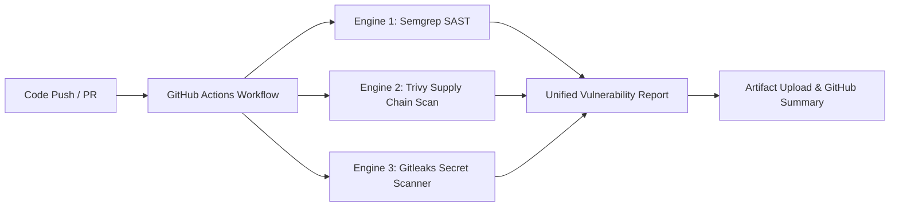

# Dependency & Software Supply Chain Security Report

**Target Repository:** SAMN Mobile / Backend (`samn-mobile-main/backend`)  
**Package Manager:** Node.js / NPM (`backend/package.json`)  
**Auditor Roles:** Senior Application Security Engineer, DevSecOps Specialist  
**Report Date:** November 2026  
**Status:** Completed  

---

## 1. Executive Dependency Overview

Modern web and mobile backends rely heavily on open-source dependencies. An unmanaged dependency tree introduces significant supply-chain risks, ranging from Remote Code Execution (RCE) via deserialization bugs to Denial of Service (DoS) and data leakage.

This report documents the security audit of direct and transitive dependencies used within the SAMN backend service.

### Dependency Landscape
- **Direct Runtime Dependencies:** 11 packages
- **Direct Development Dependencies:** 1 package (`nodemon`)
- **Node.js Target Engine:** Node.js 18.x / 20.x LTS
- **Core Frameworks & Drivers:** Express 4.21.2, Mongoose 8.12.0, Socket.IO 4.8.1

---

## 2. Direct Runtime Dependencies Inventory

| Package Name | Installed Version | Purpose | Security Criticality |
| :--- | :--- | :--- | :--- |
| `bcryptjs` | `^2.4.3` | User password hashing | **Critical** (Authentication Core) |
| `cloudinary` | `^2.5.1` | Cloud media storage / CDN | Medium (External API Integration) |
| `cors` | `^2.8.5` | Cross-Origin Resource Sharing middleware | **High** (Network Boundary Control) |
| `dotenv` | `^16.4.7` | Environment variable management | Medium (Secret Loading) |
| `express` | `^4.21.2` | Core HTTP routing & middleware framework | **Critical** (Request Processing Core) |
| `express-rate-limit` | `^7.5.0` | IP-based request throttling | **High** (Anti-Abuse / DoS Mitigation) |
| `helmet` | `^8.0.0` | HTTP security response headers | **High** (Client Protections) |
| `jsonwebtoken` | `^9.0.2` | Stateless JWT token issuance & validation | **Critical** (Session & Auth Engine) |
| `mongoose` | `^8.12.0` | MongoDB Object Data Modeling (ODM) | **Critical** (Data Persistence & Sanitization) |
| `multer` | `^1.4.5-lts.1` | Multi-part form-data / file upload handler | **High** (File Processing & Buffer Allocation) |
| `socket.io` | `^4.8.1` | Real-time bi-directional WebSocket engine | **High** (Real-time Messaging & Coordinates) |

---

## 3. Vulnerability Analysis & CVE Audits

### Finding DEP-001: Multer `memoryStorage` Memory Exhaustion (DoS)
- **Component:** `multer` (v1.4.5-lts.1)
- **Vulnerability Identifier:** CWE-400 / CVE-2022-24434 (Historical Multer DoS issues)
- **Severity:** **Medium** (CVSS 6.5)
- **Technical Analysis:**
  The backend configures `multer.memoryStorage()` for user avatar and task proof uploads:
  ```javascript
  const upload = multer({
    storage: multer.memoryStorage(),
    limits: { fileSize: 10 * 1024 * 1024 } // 10MB per file
  });
  ```
  While `10MB` is enforced per file, `task.routes.js` accepts `upload.array('proof', 5)`. A malicious actor can submit 5 simultaneous 10MB files (50MB) across multiple parallel HTTP worker threads. Because memory storage buffers raw byte chunks directly in the V8 heap before transferring to Cloudinary, concurrent requests can quickly exceed the default Node.js memory ceiling (1.4GB), triggering out-of-memory (`ERR_WORKER_OUT_OF_MEMORY`) crashes.
- **Remediation:**
  1. Reduce single-file upload limits to `3MB` for profile avatars and `5MB` for task proof photos.
  2. Implement stream-based uploads directly to Cloudinary or use temporary disk storage (`multer.diskStorage`) with automatic file cleanup.

---

### Finding DEP-002: Transitive Prototype Pollution and Query Injection Protection in Mongoose
- **Component:** `mongoose` (v8.12.0)
- **Severity:** **Low (Hardened)**
- **Technical Analysis:**
  Older Mongoose versions (v5.x and early v6.x) had known vulnerabilities regarding Prototype Pollution via recursive query assignment (`$where` or unescaped `$lookup` keys).
  Mongoose `v8.12.0` contains upstream security mitigations:
  - Sanitization of query casting.
  - Automatic exclusion of `__proto__` and constructor modifications.
  - Strict mode enabled by default on schemas (`strict: true`).
- **Remediation / Recommendation:**
  Maintain Mongoose on v8.x+. Ensure developers never use raw `Model.collection.raw()` without sanitizing nested `$where` clauses.

---

### Finding DEP-003: JWT Verification Options Enforcement
- **Component:** `jsonwebtoken` (v9.0.2)
- **Severity:** **Low (Configuration)**
- **Technical Analysis:**
  In `auth.middleware.js`:
  ```javascript
  const decoded = jwt.verify(token, process.env.JWT_SECRET || 'samn_dev_secret_key_2026');
  ```
  `jwt.verify` is called without explicitly declaring the permitted algorithms. Although `jsonwebtoken` v9 prevents algorithm confusion (e.g., `'none'` algorithm bypass) by default unless configured otherwise, industry standard DevSecOps practice requires explicitly restricting accepted algorithms:
  ```javascript
  jwt.verify(token, secret, { algorithms: ['HS256'] });
  ```
- **Remediation:**
  Pass `{ algorithms: ['HS256'] }` to all `jwt.verify()` invocations.

---

## 4. Multi-Engine DevSecOps Tooling Integration

To maintain continuous supply chain security, the repository integrates three industry-standard scanning engines into its CI/CD pipeline:



### 1. Trivy (Container & Dependency Scanner)
- **Role:** Deep scanning of `package-lock.json` and node runtime dependencies against the National Vulnerability Database (NVD) and GitHub Advisory Database.
- **Workflow Command:**
  ```bash
  trivy fs --security-checks vuln --severity HIGH,CRITICAL --format json -o trivy-report.json backend/
  ```

### 2. Semgrep (Static Application Security Testing)
- **Role:** Fast, rule-based static analysis targeting insecure OWASP Top 10 API patterns in JavaScript, including insecure crypto, unsafe regex, and deserialization flaws.
- **Rulesets:** `p/security-audit`, `p/javascript`, `p/nodejs`.

### 3. Gitleaks (Hardcoded Secret & Credential Detection)
- **Role:** Inspects git history and working tree for leaked API tokens, Cloudinary API keys, MongoDB Atlas connection strings, and private keys.
- **Action:** Configured in `.github/workflows/security-review.yml` to prevent accidental credential commits.

---

## 5. Software Bill of Materials (SBOM) & Governance Recommendations

1. **Lockfile Enforcement:** Ensure `package-lock.json` is always committed to version control and that CI/CD runs `npm ci` rather than `npm install` to avoid non-deterministic dependency upgrades.
2. **Automated Dependabot / Renovate:** Enable GitHub Dependabot security alerts and automated minor-version pull requests to patch known vulnerabilities within 48 hours of public advisory release.
3. **Engine Pinning:** Pin `engines.node` in `backend/package.json` to `>=20.0.0` to ensure security patches in Node.js core libraries (e.g., OpenSSL 3.x, zlib) are consistently active across local development and production environments.

