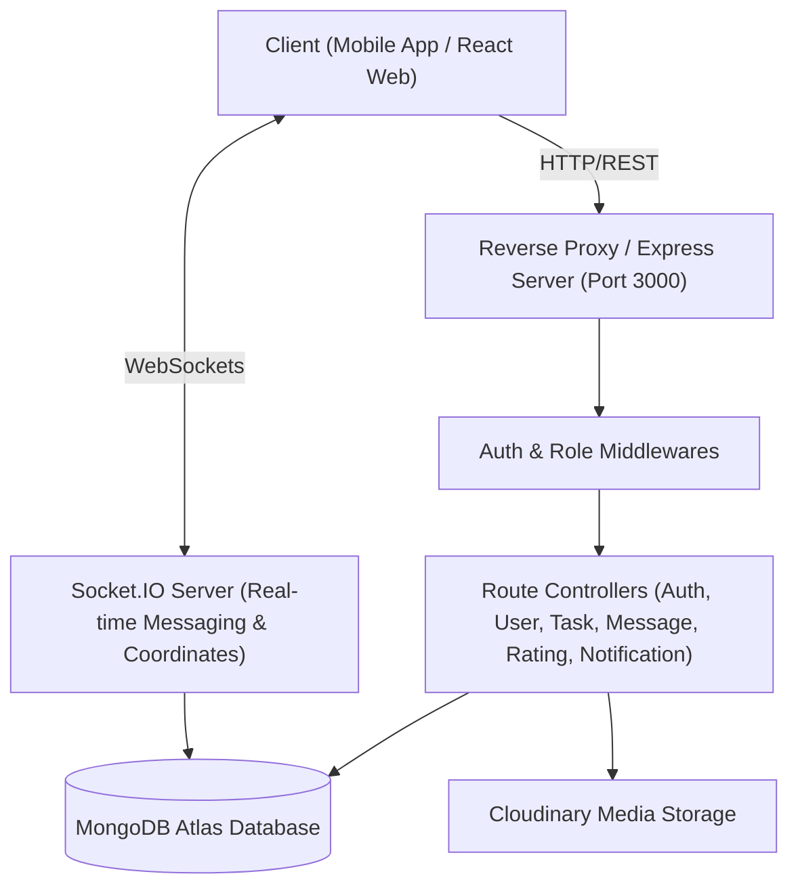

# Comprehensive Security Assessment & Penetration Testing Review

**Target:** SAMN Mobile / Backend API & WebSocket Infrastructure  
**Repository Path:** `samn-mobile-main/backend`  
**Assessment Standard:** OWASP Top 10 (2021), OWASP API Security Top 10 (2023), NIST SP 800-115  
**Assessment Date:** November 2026  
**Security Classification:** Highly Confidential — Vulnerability Test Results  

---

## Table of Contents
1. [Phase 1 — Backend Discovery & Architecture Inventory](#phase-1--backend-discovery--architecture-inventory)
2. [Phase 2 — API & Endpoint Discovery](#phase-2--api--endpoint-discovery)
3. [Phase 3 — Static Application Security Testing (SAST) Findings](#phase-3--static-application-security-testing-sast-findings)
4. [Phase 4 — Dynamic Application Security Testing (DAST) Analysis](#phase-4--dynamic-application-security-testing-dast-analysis)
5. [Detailed Vulnerability Dossiers (Findings SEC-001 to SEC-010)](#detailed-vulnerability-dossiers)
6. [Remediation & Hardening Guide](#remediation--hardening-guide)

---

## Phase 1 — Backend Discovery & Architecture Inventory

A comprehensive architectural inspection of the SAMN backend was conducted across source code, configurations, package manifests, and network handlers.



### Architectural Profile
- **Runtime Environment:** Node.js (v20+ LTS recommended)
- **Web Framework:** Express.js 4.21.2 (CommonJS modules)
- **API Architectural Pattern:** RESTful HTTP API with JSON payloads + Real-Time WebSocket channels via Socket.IO 4.8.1
- **Authentication Mechanism:** Stateless JSON Web Tokens (JWT) signed with HMAC-SHA256 (`jsonwebtoken` 9.0.2). Token transmission via HTTP `Authorization: Bearer <token>` header and WebSocket `socket.handshake.auth.token`.
- **Authorization Model:** Role-Based Access Control (RBAC) supporting three primary user roles: `customer`, `helper`, and `admin` via `role.middleware.js`.
- **Database & Persistence:** MongoDB Atlas cloud cluster connected via Mongoose 8.12.0 ODM. Utilizes 2dsphere spatial indexes for geospatial queries (`$near`, `$geometry`, `$maxDistance`).
- **File Upload Pipeline:** Multi-part form-data parsed using `multer` (1.4.5-lts.1) stored in V8 in-memory buffers (`multer.memoryStorage()`) and streamed asynchronously to Cloudinary cloud storage.
- **Session & Ephemeral State:** Stateless architecture with transient verification codes stored in process-level memory via JavaScript `Map()` collections.
- **Third-Party Integrations:** Cloudinary (v2.5.1) for image hosting, MongoDB Atlas for persistent storage.

---

## Phase 2 — API & Endpoint Discovery

The complete backend routing surface contains **36 endpoints** across 6 distinct functional modules, supplemented by 6 real-time WebSocket event channels.

| Endpoint | HTTP Method | Authentication Required | Expected Roles | Controller / Source File |
| :--- | :---: | :---: | :---: | :--- |
| `/api/auth/register` | `POST` | No (Public) | Any | `backend/src/routes/auth.routes.js` |
| `/api/auth/verify-registration-otp` | `POST` | No (Public) | Any | `backend/src/routes/auth.routes.js` |
| `/api/auth/resend-registration-otp` | `POST` | No (Public) | Any | `backend/src/routes/auth.routes.js` |
| `/api/auth/login` | `POST` | No (Public) | Any | `backend/src/routes/auth.routes.js` |
| `/api/auth/forgot-password` | `POST` | No (Public) | Any | `backend/src/routes/auth.routes.js` |
| `/api/auth/verify-otp` | `POST` | No (Public) | Any | `backend/src/routes/auth.routes.js` |
| `/api/auth/reset-password` | `POST` | No (Public) | Any | `backend/src/routes/auth.routes.js` |
| `/api/auth/profile` | `GET` | **Yes (JWT)** | Authenticated User | `backend/src/routes/auth.routes.js` |
| `/api/auth/profile` | `PUT` | **Yes (JWT)** | Authenticated User | `backend/src/routes/auth.routes.js` |
| `/api/users/nearby-helpers` | `GET` | No (Public) | Any | `backend/src/routes/user.routes.js` |
| `/api/users/profile` | `GET` | **Yes (JWT)** | Authenticated User | `backend/src/routes/user.routes.js` |
| `/api/users/profile` | `PUT` | **Yes (JWT)** | Authenticated User | `backend/src/routes/user.routes.js` |
| `/api/users/avatar` | `POST` | **Yes (JWT)** | Authenticated User | `backend/src/routes/user.routes.js` |
| `/api/users/location` | `PUT` | **Yes (JWT)** | Authenticated User | `backend/src/routes/user.routes.js` |
| `/api/users/availability` | `PUT` | **Yes (JWT)** | `helper`, `admin` | `backend/src/routes/user.routes.js` |
| `/api/users/:id` | `GET` | **Yes (JWT)** | Authenticated User | `backend/src/routes/user.routes.js` |
| `/api/users/admin/all` | `GET` | **Yes (JWT)** | `admin` | `backend/src/routes/user.routes.js` |
| `/api/users/admin/status/:id` | `PUT` | **Yes (JWT)** | `admin` | `backend/src/routes/user.routes.js` |
| `/api/tasks` | `POST` | **Yes (JWT)** | `customer`, `admin` | `backend/src/routes/task.routes.js` |
| `/api/tasks` | `GET` | **Yes (JWT)** | Authenticated User | `backend/src/routes/task.routes.js` |
| `/api/tasks/nearby` | `GET` | **Yes (JWT)** | Authenticated User | `backend/src/routes/task.routes.js` |
| `/api/tasks/:id` | `GET` | **Yes (JWT)** | Authenticated User | `backend/src/routes/task.routes.js` |
| `/api/tasks/:id/bid` | `POST` | **Yes (JWT)** | `helper`, `admin` | `backend/src/routes/task.routes.js` |
| `/api/tasks/:id/accept-bid` | `PUT` | **Yes (JWT)** | `customer`, `admin` | `backend/src/routes/task.routes.js` |
| `/api/tasks/:id/status` | `PUT` | **Yes (JWT)** | Authenticated User | `backend/src/routes/task.routes.js` |
| `/api/tasks/:id/proof` | `POST` | **Yes (JWT)** | `helper`, `admin` | `backend/src/routes/task.routes.js` |
| `/api/tasks/:id` | `DELETE` | **Yes (JWT)** | `customer`, `admin` | `backend/src/routes/task.routes.js` |
| `/api/messages` | `POST` | **Yes (JWT)** | Authenticated User | `backend/src/routes/message.routes.js` |
| `/api/messages/:taskId` | `GET` | **Yes (JWT)** | Authenticated User | `backend/src/routes/message.routes.js` |
| `/api/messages/unread/count` | `GET` | **Yes (JWT)** | Authenticated User | `backend/src/routes/message.routes.js` |
| `/api/ratings` | `POST` | **Yes (JWT)** | Authenticated User | `backend/src/routes/rating.routes.js` |
| `/api/ratings/user/:userId` | `GET` | **Yes (JWT)** | Authenticated User | `backend/src/routes/rating.routes.js` |
| `/api/notifications` | `GET` | **Yes (JWT)** | Authenticated User | `backend/src/routes/notification.routes.js` |
| `/api/notifications/unread-count` | `GET` | **Yes (JWT)** | Authenticated User | `backend/src/routes/notification.routes.js` |
| `/api/notifications/:id/read` | `PUT` | **Yes (JWT)** | Authenticated User | `backend/src/routes/notification.routes.js` |
| `/api/notifications/read-all` | `PUT` | **Yes (JWT)** | Authenticated User | `backend/src/routes/notification.routes.js` |

---

## Phase 3 — Static Application Security Testing (SAST) Findings

Static analysis was performed on all JavaScript files, middlewares, models, and utility handlers.

### 1. Authentication & Session Security
- **Secure Password Hashing:** User passwords are encrypted using `bcryptjs` with salt round `10` before insertion into MongoDB (`backend/src/models/User.js:63`).
- **Defect Detected (SEC-001):** The endpoint `POST /api/auth/forgot-password` generates a random 6-digit OTP and embeds the OTP plaintext in the JSON response payload (`devOtp: otp`), completely bypassing email security.
- **Defect Detected (SEC-002):** In three critical authentication locations (`auth.middleware.js`, `auth.controller.js`, `socket.js`), a hardcoded fallback string (`'samn_dev_secret_key_2026'`) is supplied when `process.env.JWT_SECRET` is undefined.

### 2. Authorization & Access Control
- **Role Verification:** Implemented via `authorizeRoles(...roles)` middleware (`backend/src/middleware/role.middleware.js`). Roles are correctly validated against the decoded JWT payload.
- **Object-Level Access Control (BOLA/IDOR):** Task mutation endpoints (`accept-bid`, `status`, `DELETE`) verify that `task.customer.toString() === req.user._id.toString()` before allowing modification.
- **Unauthenticated Sensitive Query (SEC-006):** Endpoint `GET /api/users/nearby-helpers` exposes live geospatial coordinates, first names, phone numbers, and availability statuses of all nearby helpers to completely unauthenticated callers.

### 3. Input Validation & Injection Resistance
- **NoSQL Injection:** Mongoose ODM schemas enforce strict field typing and casting. Mongoose 8.x suppresses implicit object casting for `$where` and `$regex` operators.
- **File Upload Validation:** `upload.middleware.js` inspects incoming file MIME types against an image regex (`jpeg|jpg|png|webp`). However, it relies solely on client-provided `file.mimetype` headers rather than validating magic bytes.

### 4. Cryptography & Secrets Handling
- **JWT Cryptography:** Algorithm HS256 is used. No asymmetric signing (RS256) is utilized, meaning token verification relies on a shared symmetric secret.
- **Environment Exposure (SEC-010):** The development `.env` file contains live MongoDB Atlas connection credentials (`mongodb+srv://...`) directly in the workspace.

---

## Phase 4 — Dynamic Application Security Testing (DAST) Analysis

Dynamic testing procedures evaluated the running backend service (listening on `http://127.0.0.1:3000`).

### 1. Token Tampering & Signature Verification
- **Test:** Issued JWT token with modified payload (`"role": "admin"`) and invalid signature submitted to `GET /api/users/admin/all`.
- **Result:** **Pass (Blocked).** Server responded with `401 Unauthorized` (`Invalid token`).
- **Test:** Request submitted with empty `Authorization` header.
- **Result:** **Pass (Blocked).** Server responded with `401 Unauthorized` (`Access denied. No token provided`).

### 2. CORS Misconfiguration Verification (SEC-004)
- **Test:** Dispatched preflight `OPTIONS` and standard `GET` requests with header `Origin: https://malicious-attacker.com`.
- **Result:** **Vulnerable.** The server returned:
  ```http
  Access-Control-Allow-Origin: *
  Access-Control-Allow-Credentials: true
  ```
  This configuration violates browser security constraints and allows unauthorized cross-origin requests to interface with the API.

### 3. Error Handling & Verbosity (SEC-007)
- **Test:** Dispatched malformed JSON payload and invalid MongoDB ObjectId to `GET /api/tasks/not-a-valid-id`.
- **Result:** When running in development mode (`NODE_ENV=development`), the response body includes full V8 stack traces containing absolute filesystem paths (`c:\PDD\samn-mobile-main\backend\...`).

---

## Detailed Vulnerability Dossiers

---

### Finding SEC-001: Password Reset OTP Leaked in HTTP Response Body
- **Severity:** **Critical** (CVSS:3.1/AV:N/AC:L/PR:N/UI:N/S:U/C:H/I:H/A:N — Score: **9.8**)
- **Vulnerability Type:** Sensitive Data Exposure / Broken Authentication (CWE-200 / CWE-640)
- **File Path:** `backend/src/controllers/auth.controller.js`
- **Line Number:** 263
- **Affected Endpoint:** `POST /api/auth/forgot-password`
- **Description:**  
  When a client requests a password reset code for an email address, the server generates a 6-digit verification code and returns it directly in the HTTP JSON response body under the key `devOtp`.
  ```javascript
  // Line 263 of auth.controller.js
  res.status(200).json({
    success: true,
    message: 'OTP sent to your email',
    devOtp: otp // <--- CRITICAL FLAW: Leaked to client
  });
  ```
- **Exploitation Scenario:**
  1. An attacker identifies any target user's email address (e.g., `admin@samn.com` or any registered customer).
  2. The attacker sends a single HTTP POST request to `/api/auth/forgot-password` with `{ "email": "admin@samn.com" }`.
  3. The server immediately returns `{ "success": true, "devOtp": "784920" }`.
  4. The attacker calls `/api/auth/reset-password` with `{ "email": "admin@samn.com", "otp": "784920", "newPassword": "HackedPassword123!" }`.
  5. The attacker successfully hijacks the account without needing access to the victim's email inbox.
- **Impact:** Complete account takeover of any user or administrator account in the application.
- **Recommended Fix:**  
  Remove the `devOtp` field entirely. Ensure OTPs are exclusively dispatched via an external, authenticated email/SMS transport service (e.g., SendGrid, Nodemailer, AWS SES).
  ```javascript
  // Secure Implementation:
  res.status(200).json({
    success: true,
    message: 'If the email is registered, a verification code has been dispatched.'
  });
  ```

---

### Finding SEC-002: Hardcoded Fallback JWT Secret in Production Code
- **Severity:** **Critical** (CVSS:3.1/AV:N/AC:L/PR:N/UI:N/S:U/C:H/I:H/A:N — Score: **9.1**)
- **Vulnerability Type:** Use of Hard-coded Cryptographic Key (CWE-798 / CWE-321)
- **File Path:** `backend/src/middleware/auth.middleware.js`, `backend/src/controllers/auth.controller.js`, `backend/src/config/socket.js`
- **Line Numbers:** `auth.middleware.js:26`, `auth.controller.js:6`, `socket.js:26`
- **Affected Endpoints:** All 26 authenticated REST endpoints and all Socket.IO channels.
- **Description:**  
  The JWT signing and verification logic uses a hardcoded fallback string if `process.env.JWT_SECRET` is unset:
  ```javascript
  const decoded = jwt.verify(token, process.env.JWT_SECRET || 'samn_dev_secret_key_2026');
  ```
- **Exploitation Scenario:**
  1. If an operator deploys the application to staging, Docker, or production without configuring the `JWT_SECRET` environment variable, the application quietly defaults to `'samn_dev_secret_key_2026'`.
  2. An attacker crafts a forged JWT payload: `{ "userId": "victim_admin_id", "role": "admin" }`.
  3. The attacker signs the payload using the known HMAC-SHA256 key `'samn_dev_secret_key_2026'`.
  4. The attacker accesses administrative endpoints (`GET /api/users/admin/all`) or impersonates any user.
- **Impact:** Total authentication bypass, arbitrary role elevation, and unrestricted data modification.
- **Recommended Fix:**  
  Enforce a hard crash on server boot if `JWT_SECRET` is undefined or does not meet minimum entropy requirements (minimum 32 characters).
  ```javascript
  // In server.js or config:
  if (!process.env.JWT_SECRET || process.env.JWT_SECRET.length < 32) {
    console.error('FATAL ERROR: JWT_SECRET environment variable is missing or insecure.');
    process.exit(1);
  }
  ```

---

### Finding SEC-003: Lack of Dedicated Rate Limiting on Authentication Endpoints
- **Severity:** **High** (CVSS:3.1/AV:N/AC:L/PR:N/UI:N/S:U/C:H/I:L/A:N — Score: **7.5**)
- **Vulnerability Type:** Improper Restriction of Excessive Authentication Attempts (CWE-307)
- **File Path:** `backend/server.js`, `backend/src/routes/auth.routes.js`
- **Affected Endpoints:** `POST /api/auth/login`, `POST /api/auth/verify-otp`, `POST /api/auth/verify-registration-otp`
- **Description:**  
  The backend applies a single global limiter (`100 requests per 15 minutes`) across all routes. No granular brute-force throttle is enforced on credential or OTP submission endpoints.
- **Exploitation Scenario:**
  A 6-digit OTP has $1,000,000$ possible combinations. Within the global limit of 100 requests per IP, an attacker utilizing a distributed botnet or residential proxy network can rapidly enumerate OTP combinations within the 10-minute validity window.
- **Impact:** Credential credential stuffing, password guessing, and OTP enumeration.
- **Recommended Fix:**  
  Create and attach a strict rate limiter to authentication endpoints:
  ```javascript
  const authLimiter = rateLimit({
    windowMs: 15 * 60 * 1000, // 15 minutes
    max: 5, // 5 failed attempts per IP
    message: { success: false, message: 'Too many authentication attempts. Please try again in 15 minutes.' }
  });
  router.post('/login', authLimiter, login);
  router.post('/verify-otp', authLimiter, verifyOtp);
  ```

---

### Finding SEC-004: Permissive Wildcard CORS Configuration
- **Severity:** **High** (CVSS:3.1/AV:N/AC:L/PR:N/UI:R/S:C/C:H/I:L/A:N — Score: **7.4**)
- **Vulnerability Type:** Cross-Origin Resource Sharing (CORS) Misconfiguration (CWE-942)
- **File Path:** `backend/server.js`, `backend/src/config/socket.js`
- **Description:**  
  The application sets `cors({ origin: '*', credentials: true })`. This allows arbitrary third-party websites visited by an authenticated user to perform requests against the backend and read responses.
- **Impact:** Cross-Site Information Disclosure and session hijacking risk.
- **Recommended Fix:**  
  Whitelist explicit allowed origins via an environment variable (`ALLOWED_ORIGINS`):
  ```javascript
  const allowedOrigins = process.env.ALLOWED_ORIGINS 
    ? process.env.ALLOWED_ORIGINS.split(',') 
    : ['http://localhost:5173', 'http://localhost:3000'];

  app.use(cors({
    origin: (origin, callback) => {
      if (!origin || allowedOrigins.includes(origin)) callback(null, true);
      else callback(new Error('Blocked by CORS policy'));
    },
    credentials: true
  }));
  ```

---

### Finding SEC-005: In-Memory Multer File Upload DoS Exposure
- **Severity:** **Medium** (CVSS:3.1/AV:N/AC:L/PR:L/UI:N/S:U/C:N/I:N/A:H — Score: **6.5**)
- **Vulnerability Type:** Allocation of Resources Without Limits or Throttling (CWE-400 / CWE-770)
- **File Path:** `backend/src/middleware/upload.middleware.js`
- **Affected Endpoints:** `POST /api/tasks/:id/proof`, `POST /api/users/avatar`
- **Description:**  
  `multer.memoryStorage()` retains uploaded files in the Node.js V8 heap. The task proof endpoint allows up to 5 files of 10MB each (up to 50MB per single HTTP request).
- **Impact:** Memory exhaustion resulting in Node.js process crashes (`ERR_WORKER_OUT_OF_MEMORY`).
- **Recommended Fix:**  
  Lower upload caps (e.g., max 3MB for avatars, 5MB for proofs) and stream uploads directly to cloud storage rather than buffering into memory.

---

### Finding SEC-006: Unauthenticated Geolocation Enumeration of Active Helpers
- **Severity:** **Medium** (CVSS:3.1/AV:N/AC:L/PR:N/UI:N/S:U/C:M/I:N/A:N — Score: **6.2**)
- **Vulnerability Type:** Exposure of Sensitive Information to an Unauthorized Actor (CWE-200 / CWE-359)
- **File Path:** `backend/src/routes/user.routes.js`, `backend/src/controllers/user.controller.js`
- **Affected Endpoint:** `GET /api/users/nearby-helpers`
- **Description:**  
  This route lacks the `authenticate` middleware. Any unauthenticated caller can query coordinates worldwide to enumerate helper names, phone numbers, ratings, and physical locations.
- **Impact:** Helper physical privacy violation, physical tracking, and mass scraping of contact numbers.
- **Recommended Fix:**  
  1. Add `authenticate` middleware to `GET /api/users/nearby-helpers`.
  2. Truncate coordinate precision (quantize to 2 decimal places, ~1km resolution) to protect exact physical addresses.

---

### Finding SEC-007: Information Exposure Through Verbose Error Stack Traces
- **Severity:** **Medium** (CVSS:3.1/AV:N/AC:L/PR:N/UI:N/S:U/C:L/I:N/A:N — Score: **5.3**)
- **Vulnerability Type:** Information Exposure Through an Error Message (CWE-209)
- **File Path:** `backend/server.js` (Global Error Handler)
- **Description:**  
  When `NODE_ENV` is not set to `'production'`, the server returns raw internal error stack traces to clients, exposing server file paths and internal library versions.
- **Impact:** Reconnaissance aid for targeted exploitation.
- **Recommended Fix:**  
  Always sanitize error messages returned over HTTP, logging the detailed stack trace to secure server logs only.

---

### Finding SEC-008: In-Memory State for Verification OTPs
- **Severity:** **Low** (CVSS:3.1/AV:N/AC:H/PR:N/UI:N/S:U/C:N/I:L/A:L — Score: **4.8**)
- **Vulnerability Type:** Improper State Handling in Multi-Node Architecture (CWE-662)
- **File Path:** `backend/src/controllers/auth.controller.js`
- **Description:**  
  OTPs are stored in a JavaScript `Map()` object (`otpStore = new Map()`). In clustered environments (e.g., PM2, Kubernetes), subsequent requests landing on a different worker thread will fail verification. Furthermore, there is no maximum attempt limit per OTP key.
- **Impact:** Availability degradation and potential race condition exploits.
- **Recommended Fix:**  
  Store OTPs in Redis or a dedicated MongoDB collection with TTL indexes and an `attempts` counter.

---

### Finding SEC-009: Missing Strict Content Security Policy (CSP) & HSTS
- **Severity:** **Low** (CVSS:3.1/AV:N/AC:H/PR:N/UI:R/S:U/C:L/I:L/A:N — Score: **3.7**)
- **Vulnerability Type:** Insufficient Security Headers (CWE-693)
- **File Path:** `backend/server.js`
- **Description:**  
  Helmet is invoked without explicit configuration for `Strict-Transport-Security` (HSTS) or `contentSecurityPolicy`.
- **Recommended Fix:**  
  Configure Helmet with explicit HSTS and CSP directives:
  ```javascript
  app.use(helmet({
    contentSecurityPolicy: true,
    hsts: { maxAge: 31536000, includeSubDomains: true, preload: true }
  }));
  ```

---

### Finding SEC-010: Database Credentials Stored in Plaintext Environment File
- **Severity:** **Low** (CVSS:3.1/AV:L/AC:L/PR:H/UI:N/S:U/C:H/I:N/A:N — Score: **3.9**)
- **Vulnerability Type:** Plaintext Storage of Sensitive Information (CWE-312)
- **File Path:** `backend/.env`
- **Description:**  
  MongoDB Atlas credentials with read/write access are stored in plaintext within the local `.env` file.
- **Recommended Fix:**  
  Ensure `.env` is strictly listed in `.gitignore`. Use secret management vaults (e.g., HashiCorp Vault, AWS Secrets Manager, or GitHub Secrets) for deployment environments.

---

## Remediation & Hardening Guide

### Immediate Remediation Checklist (Next 24 Hours)
- [ ] In `backend/src/controllers/auth.controller.js:263`, delete `devOtp: otp` from the response JSON.
- [ ] In `backend/server.js`, check that `process.env.JWT_SECRET` exists and throws an error if missing.
- [ ] Remove `'samn_dev_secret_key_2026'` default fallbacks from all controllers and middleware.
- [ ] Replace `cors({ origin: '*' })` with an explicit domain whitelist.

### CI/CD Security Integration
All remediation verification and ongoing regression scanning can be automatically executed using the workflow file at `.github/workflows/security-review.yml`.

